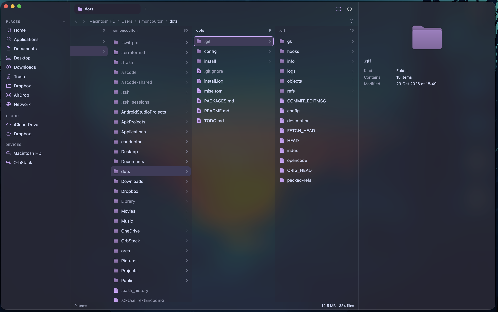
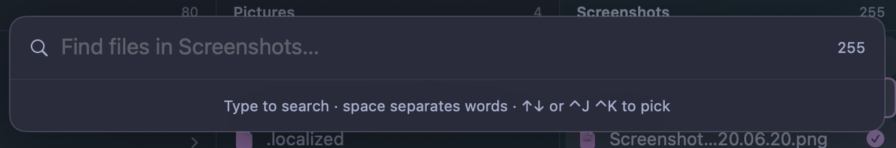
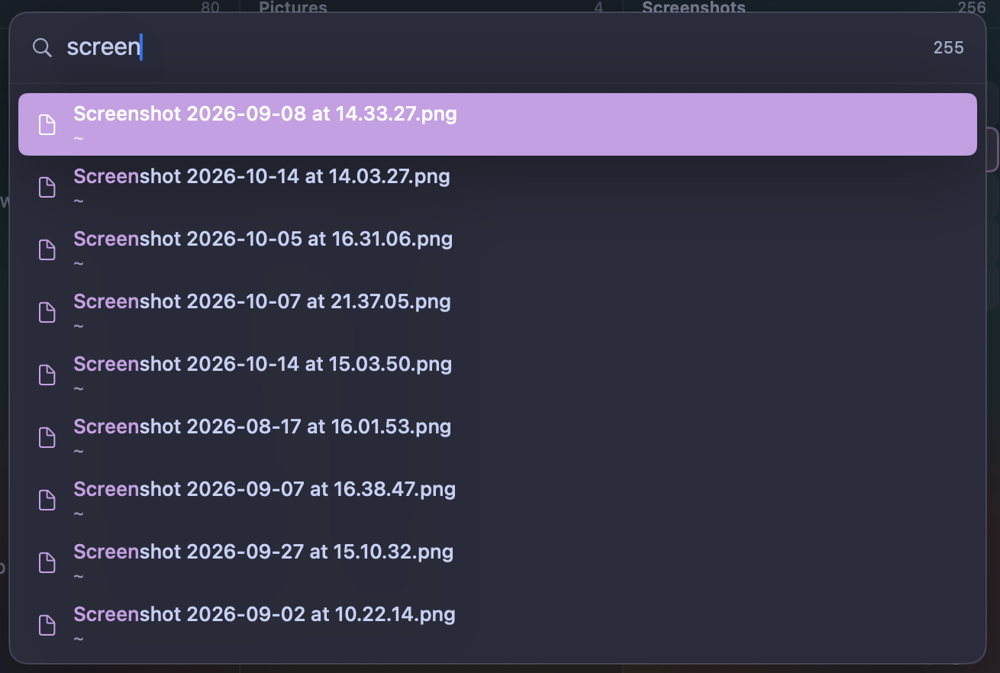
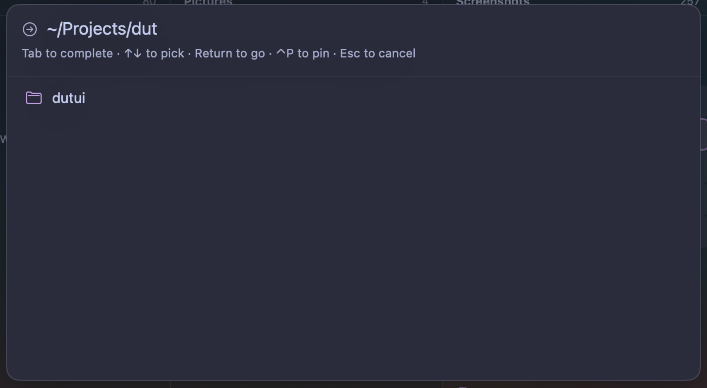
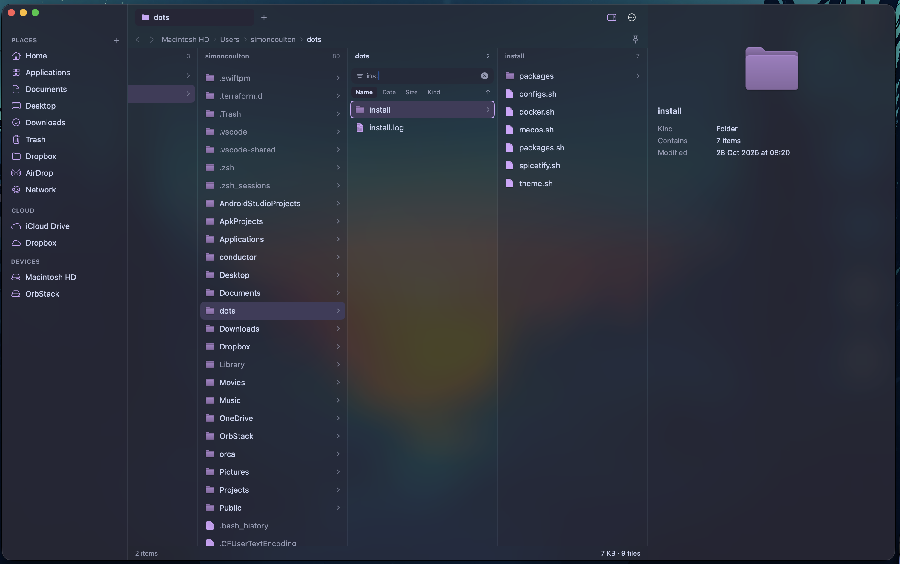
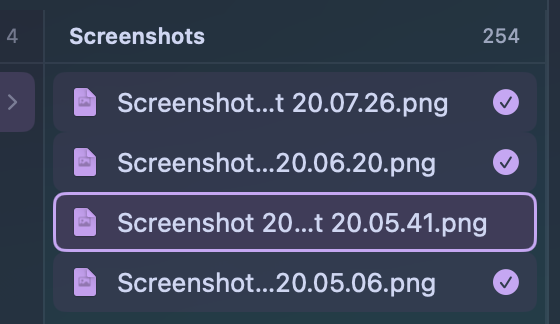
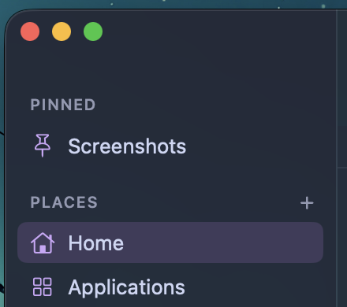
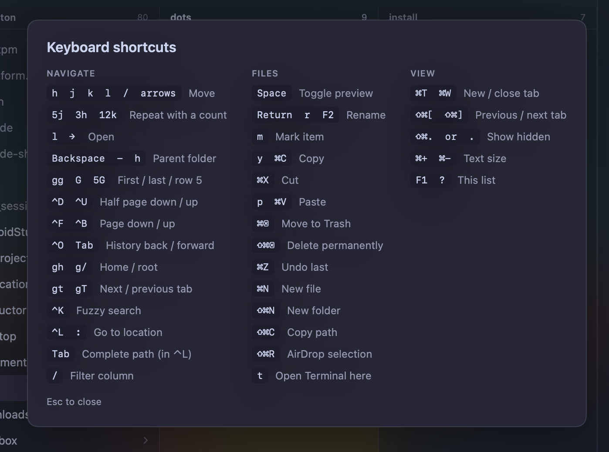

# Seam

A keyboard-first file manager for macOS: Miller columns, fuzzy search, instant previews, themes. Native Swift (SwiftUI + AppKit), no dependencies.

## Build and run

    scripts/bundle.sh          # release build -> build/Seam.app
    scripts/bundle.sh debug
    open build/Seam.app

Builds with the Command Line Tools alone (macOS 14+). `@State` is replaced by `Local<T>` because the SwiftUI macro plugin ships only with full Xcode. With Xcode installed, you can switch back.

## Keys

Press `F1` or `?` in the app. Highlights: `Cmd+O` go to location (Tab completes folders, or shares after `smb://server/`), `y` / `p` copy / paste (also ⌘C / ⌘V), drag sidebar rows to reorder, `h j k l` move, `l` open, `Return` rename, `Space` preview (`Shift+Space` for a popup), `Cmd+F` find files under the current folder (indexed only while it is open), `/` filter a column, `m` mark, `Shift+M` mark everything from the last mark to here, `r` rename too.

### Find

`Cmd+F` fuzzy-searches the current folder. The index is built only while the overlay is open and freed when it closes.

### Go to location

`Cmd+O` (or `:`) opens the location bar. Tab completes folders, and `Ctrl+P` pins the address.

### Filter, mark and pin

`/` filters a single column, with sort tabs and a direction button.

`m` (or ⌘-click) marks rows so copy, move and trash act on all of them.

Pin a folder to keep it at the top of the sidebar.

### Shortcuts

Custom themes: drop a TOML file in `~/Library/Application Support/Seam/themes/` (see Theme menu > Save Current Theme).

## Not yet done

SFTP, XPC-sandboxed preview helpers, Sparkle updates and release channels, localization, split panes.

## Footer sizes

The footer shows the size of the selected item, or of everything marked. Folders are walked with
`getattrlistbulk` on a small thread pool (the technique from dutui), with live counts while it runs,
hard links counted once, and the walk cancelled as soon as the selection moves. Finished folders are
cached until something on disk changes. Hover the size for the figure on disk.

## Credits

Heavily inspired by [Strata](https://stratafiles.io).

The icon is drawn by `scripts/make-icon.swift` (`swift scripts/make-icon.swift Resources/AppIcon.icns`).
